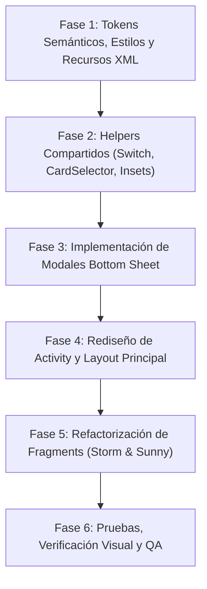

# Plan de Modernización de UI: Adopción del Estilo `Dot` y Sistema de Modales Bottom Sheet (Material 3)

## 1. Contexto y Objetivos

El repositorio `Dot` (`com.teamwolf.dot`, Live Wallpaper "Neural Grid") representa una evolución de referencia para la interfaz de configuración de fondos de pantalla interactivos en Android moderno (Android 15+ / TargetSdk 35+). `Dot` introdujo mejoras esenciales en ergonomía, compatibilidad Edge-to-Edge nativa, selectores de tarjetas adaptativos y robustez ante peculiaridades de capas de fabricantes (como Samsung OneUI).

Sin embargo, para completar la modernización de la experiencia de usuario en `wallpaper`, es necesario llevar la interacción modal más allá de los diálogos emergentes clásicos (`AlertDialog` centrados). Siguiendo los estándares de las aplicaciones móviles más pulidas de la industria (**WhatsApp Android** para modales informativos/educativos y **Cash App** para selectores interactivos y ajustes de parámetros), este plan integra un **Sistema Unificado de Modal Bottom Sheets (Material 3)**.

Este documento establece la evaluación arquitectónica de `Dot`, el análisis de la referencia visual de modales y la hoja de ruta integral para ejecutar la migración sin romper la funcionalidad multiefecto existente (*Tormenta* y *Día y Noche*).

---

## 2. Referencia Visual: Sistema de Modales Bottom Sheet

Basado en la comparativa de diseño de modales modernos (referencia visual: **Cash App** y **WhatsApp Android**):

```
┌────────────────────────────────────────────────────────┐
│                   MODAL BOTTOM SHEET                   │
│                                                        │
│                  ─── [Drag Handle] ───                 │
│  [X]                                                   │
│                        ╭─────╮                         │
│                        │  ✦  │  Hero Badge Circular    │
│                        ╰─────╯  (Acento pastel)        │
│                                                        │
│               Título Prominente Bold                   │
│                                                        │
│   ┌────────────────────────────────────────────────┐   │
│   │ ◉  Ítem con icono guía y descripción detallada │   │
│   │ 🔒 Ítem con icono guía y descripción detallada │   │
│   └────────────────────────────────────────────────┘   │
│   ── O bien selectores segmentados / sliders (HSV) ──  │
│                                                        │
│   ┌────────────────────────────────────────────────┐   │
│   │           [ BOTÓN PRIMARIO (CTA PILL) ]         │   │
│   └────────────────────────────────────────────────┘   │
│               Botón secundario de texto                │
│                                                        │
│           ══════ [Nav Bar Inset / Gestos] ══════       │
└────────────────────────────────────────────────────────┘
```

### 2.1. Patrón 1: Modal Informativo y de Ayuda (Estilo WhatsApp Android)
* **Drag Handle Superior**: Indicador redondeado en píldora (`32dp x 4dp`) centrado en la parte superior, proporcionando una pista visual clara de que el modal se puede arrastrar hacia abajo para descartar.
* **Botón de Cierre Superior (X)**: Icono de cierre en la esquina superior izquierda (o derecha) para accesibilidad táctil explícita e intuitiva.
* **Hero Badge Circular con Micro-Detalles**:
  * Contenedor circular flotante (`56dp x 56dp`, radio `28dp`) con fondo pastel temático (`@color/settings_card_selected` o acento con baja opacidad).
  * Icono vectorial central (`28dp`) tintado con el color de acento (`@color/settings_accent`).
  * Detalles decorativos (estrellas o halos) que elevan la jerarquía visual del diálogo.
* **Título Central en Negrita**: Tipografía clara y destacada (`20sp` bold, `settings_text_primary`) centrada horizontalmente.
* **Cuerpo Estructurado por Filas (Leading Icons)**:
  * En lugar de muros de texto HTML planos e ilegibles, el contenido se desglosa en filas informativas.
  * Cada fila cuenta con un icono temático vectorial a la izquierda (`24dp`, tintado suavemente) seguido de un texto explicativo con alto contraste y espaciado cómodo (`14sp`, `settings_text_secondary`).
* **Acciones en Pie Jerárquico**:
  * **Botón Primario (CTA)**: Botón de ancho completo tipo píldora (`cornerRadius="28dp"`), con fondo sólido de acento (`settings_accent`) y texto en alto contraste (ej. *"Entendido"*).
  * **Botón Secundario de Enlace**: Botón de texto inferior (`Widget.Material3.Button.TextButton`) para acciones contextuales adicionales (ej. *"Ver tutorial interactivo"*).
* **Gestión de Insets de Navegación**: Margen inferior dinámico que respeta la barra de navegación del sistema (`navigationBars()`).

### 2.2. Patrón 2: Modal de Ajustes Interactivos y Color (Estilo Cash App)
* **Controles Segmentados en Píldora (Pill Chips)**:
  * Agrupaciones de opciones en cajas redondeadas con borde sutil (`strokeColor="@color/settings_stroke"`).
  * El estado activo resalta con fondo de acento y tipografía destacada (ej. selector de presets de color o densidades rápidas).
* **Controles Incrementales y Sliders Fluidos**:
  * Botones circulares o en píldora con símbolos `+` y `-` para ajustes de precisión, combinados con sliders continuos (Tono, Saturación, Brillo).
* **Botones de Confirmación Inmediata**:
  * Botón secundario *"Restablecer"* en texto plano o neutro.
  * Botón primario *"Aplicar"* de ancho completo al fondo del modal.

---

## 3. Evaluación de la UI de `Dot` (Arquitectura Base)

### 3.1. Arquitectura de Layout y Compatibilidad Edge-to-Edge
* **Edge-to-Edge Nativo (Android 15+ / API 35+)**: En `WallpaperSettingsActivity.kt`, listeners de `WindowInsetsCompat.Type.systemBars()` inyectan el padding dinámico a la cabecera superior y al contenedor de acciones inferior.
* **Barra Inferior Flotante Pinned (`buttonContainer`)**: Botón *"Establecer fondo de pantalla"* anclado permanentemente con elevación (`8dp`, `translationZ="8dp"`), evitando que el usuario deba scrollear toda la configuración para aplicar el wallpaper.
* **Scroll Centralizado**: Desplazamiento gestionado por un único `ScrollView` con `fillViewport="true"`.

### 3.2. Cabecera y Selector de Tema en Pista Segmentada (Pill Track)
* **Header Principal**:
  * Título destacado (`22sp bold`).
  * Subtítulo descriptivo secundario (`12sp`).
  * Botón de ayuda integrado (`buttonHeaderHelp`) a la derecha con ripple circular.
* **Selector de Tema Segmentado**:
  * Encapsulado en `MaterialCardView` (`cardCornerRadius="14dp"`, borde de 1dp).
  * Opciones (`Auto`, `Claro`, `Oscuro`) en píldoras (`cardCornerRadius="10dp"`) con estado activo de alto contraste.

### 3.3. Estructura de Acordeones Material 3 Flat
* **Contenedores Flat**: `MaterialCardView` sin elevación (`cardElevation="0dp"`), esquinas redondeadas (`16dp`) y borde fino (`1dp`, `strokeColor="@color/settings_stroke"`).
* **Badges Circulares de 36dp**: Icono vectorial de 20dp centrado en tarjeta circular (`36dp x 36dp`, radio 18dp) con fondo suave pastel.
* **Resúmenes Dinámicos (Summaries)**: Subtítulos informativos (11sp) con el resumen de parámetros activos.
* **Animaciones y Exclusividad**: Transición fluida con rotación de 180° del chevron y auto-colapso de otros acordeones.

### 3.4. Helpers Centralizados de UI
* **`SettingsSwitchHelper`**: Fila completa interactiva, conmutación suave, blindaje contra el bug de Samsung OneUI (`showText = false`, `textOn = ""`, `textOff = ""`) y soporte para `setLocked` atenuando vistas hijas a `0.38f`.
* **`SettingsCardSelectorHelper`**: Distribución proporcional (`weight="1"`) para ≤ 4 tarjetas y rejilla automática para > 4 tarjetas, eliminando scrolls horizontales innecesarios.

---

## 4. Matriz Comparativa: Estado Actual vs Propuesta Integral

| Componente / Característica | Estado Actual en `wallpaper` | Estándar `Dot` | Propuesta Nueva con Modales Material 3 |
|---|---|---|---|
| **Diálogo de Ayuda** | `MaterialAlertDialogBuilder` tradicional centrado, bloque de texto HTML plano. | Diálogo básico o alert dialog. | **`HelpBottomSheetDialogFragment` (Patrón WhatsApp)** con drag handle, botón X, hero badge circular de 56dp, lista de tips con leading icons, botón CTA pill y enlace al tutorial. |
| **Selector de Color** | `dialog_color_picker.xml` (diálogo RGB clásico centrado con sliders y presets flotantes). | `dialog_color_mixer.xml` (HSV en diálogo tradicional). | **`ColorMixerBottomSheetDialogFragment` (Patrón Cash App / WhatsApp)** con drag handle, live preview en píldora, sliders HSV, chips segmentados de presets y botón primario full-width "Aplicar". |
| **Soporte Edge-to-Edge** | Insets no configurados para API 35 en Activity ni en diálogos. | Activity maneja insets; diálogos estándar. | **Soporte total en Activity y en todos los Bottom Sheets** (`WindowInsetsCompat` para respetar barra de navegación de gestos). |
| **Botón de Aplicación** | Al fondo del scroll o en layouts internos de fragments. | Barra flotante inferior fija con sombra de 8dp. | **Barra flotante persistente** con botón píldora elevado y padding seguro de navegación. |
| **Cabecera** | Título simple centrado; botón de ayuda interno. | Header con título, subtítulo y botón de ayuda. | **Header M3** unificado que abre el nuevo `HelpBottomSheetDialogFragment` contextual. |
| **Selector de Tema** | 3 tarjetas aisladas con márgenes externos. | Pista segmentada común en tarjeta contenedora. | **Pista segmentada M3** encapsulada con esquinas de 14dp y badges activos. |
| **Filas con Switch** | Switch manual por ID, riesgo de crash en OneUI. | `SettingsSwitchHelper` con guard OneUI. | **`SettingsSwitchHelper`** con soporte para bloqueo y animación de estado. |
| **Selectores de Tarjetas** | `HorizontalScrollView` obligatorio en fila fija de 86dp. | Adaptativo: peso equitativo ≤4 y grid >4. | **`SettingsCardSelectorHelper` adaptativo** sin scroll horizontal forzado. |

---

## 5. Arquitectura del Sistema de Modales Bottom Sheet

### 5.1. Estilos y Temas de los Modales (`themes.xml` y `values/styles.xml`)

```xml
<!-- Estilo para los Bottom Sheets redondeados -->
<style name="Theme.Wallpaper.ModalBottomSheet" parent="Theme.Material3.DayNight.BottomSheetDialog">
    <item name="bottomSheetStyle">@style/Widget.Wallpaper.BottomSheet</item>
    <item name="android:windowIsFloating">false</item>
    <item name="android:navigationBarColor">@android:color/transparent</item>
    <item name="android:statusBarColor">@android:color/transparent</item>
</style>

<style name="Widget.Wallpaper.BottomSheet" parent="Widget.Material3.BottomSheet.Modal">
    <item name="backgroundTint">@color/settings_card_bg</item>
    <item name="shapeAppearance">@style/ShapeAppearance.Wallpaper.BottomSheet</item>
    <item name="elevation">8dp</item>
</style>

<style name="ShapeAppearance.Wallpaper.BottomSheet" parent="ShapeAppearance.Material3.LargeComponent">
    <item name="cornerSizeTopLeft">28dp</item>
    <item name="cornerSizeTopRight">28dp</item>
    <item name="cornerSizeBottomLeft">0dp</item>
    <item name="cornerSizeBottomRight">0dp</item>
</style>
```

### 5.2. Componente 1: `HelpBottomSheetDialogFragment` (Ayuda Contextual)
* **Archivo de Layout**: `res/layout/modal_bottom_sheet_help.xml`
* **Estructura del Layout**:
  1. `dragHandle`: `View` de `32dp x 4dp`, centrado horizontalmente con `background="@drawable/bg_drag_handle"`.
  2. `buttonClose`: `ImageButton` de `24dp` en la esquina superior izquierda con icono de cruz (`@drawable/ic_close`) y ripple sin bordes.
  3. `heroBadgeContainer`: `MaterialCardView` circular (`56dp x 56dp`, radio `28dp`), fondo `@color/settings_card_selected`, elevación `0dp`, centrado.
  4. `heroIcon`: `ImageView` de `28dp` con icono representativo del modo (`ic_storm_badge` o `ic_sunny_badge`), tintado `@color/settings_accent`.
  5. `textTitle`: `TextView` con estilo bold (`20sp`), centrado.
  6. `containerFeatures`: `LinearLayout` vertical que aloja los puntos clave (inflados dinámicamente o estructurados):
     - Cada elemento usa `res/layout/item_modal_feature.xml`:
       - `featureIcon`: `ImageView` en badge circular pequeño (`32dp`), con icono temático.
       - `featureText`: `TextView` con texto explicativo en dos líneas o texto formateado.
  7. `buttonPrimary`: `MaterialButton` tipo píldora (`cornerRadius="28dp"`), ancho completo (`match_parent`), texto *"Entendido"*, fondo `@color/settings_accent`.
  8. `buttonSecondary`: `MaterialButton` estilo texto (`@style/Widget.Material3.Button.TextButton`), centrado, texto *"Ver tutorial interactivo"*.
* **Comportamiento**:
  - Al abrirse, ajusta automáticamente `state = BottomSheetBehavior.STATE_EXPANDED` y `skipCollapsed = true`.
  - Si el usuario pulsa *"Ver tutorial interactivo"*, descarta el sheet e invoca `(activity as? WallpaperSettingsActivity)?.startTutorial(tabIndex)`.
  - Insets: aplica padding inferior automático para la barra de navegación.

### 5.3. Componente 2: `ColorMixerBottomSheetDialogFragment` (Mezclador HSV)
* **Archivo de Layout**: `res/layout/modal_bottom_sheet_color_mixer.xml`
* **Estructura del Layout**:
  1. `dragHandle` superior centrado.
  2. `buttonClose` superior izquierdo.
  3. `headerTitle`: *"Personalizar Color"* (`18sp bold`).
  4. `colorPreviewCard`: `MaterialCardView` alargado en píldora (`cornerRadius="16dp"`), mostrando el color actual en vivo y el texto Hex editable al centro.
  5. Sección de Sliders HSV:
     - Tono (0 - 360°): `Slider` con degradado arcoíris.
     - Saturación (0 - 100%): `Slider` del tono actual.
     - Brillo / Valor (0 - 100%): `Slider` de negro al tono actual.
  6. Sección de Presets Rápidos (Estilo Cash App):
     - Fila horizontal de chips o píldoras con los presets más comunes del efecto.
     - Selección activa con borde acentuado de `2dp` y escala visual.
  7. Botón Primario: *"Aplicar Color"* (`MaterialButton` pill full-width).
  8. Botón Secundario: *"Restablecer"* o *"Cancelar"*.
* **Callback**: `onColorSelected: (Int) -> Unit` reactivo.

---

## 6. Plan de Implementación por Fases



### Fase 1: Tokens Semánticos, Estilos y Recursos XML
1. **Colores y Atributos**:
   - Consolidar en `values/colors.xml` y `values-night/colors.xml`:
     - Tokens de tarjetas y hojas: `settings_card_bg`, `settings_card_bg_alt`, `settings_card_selected`, `settings_stroke`.
     - Tokens de modales: `bottom_sheet_drag_handle` (`#D8DAE3` / `#343542`), `bottom_sheet_scrim`.
2. **Estilos de Bottom Sheet**:
   - Declarar en `values/themes.xml` y `values-night/themes.xml` el estilo `Theme.Wallpaper.ModalBottomSheet` y la forma `ShapeAppearance.Wallpaper.BottomSheet` con esquinas superiores de 28dp.
3. **Drawables Vectoriales**:
   - Crear `bg_drag_handle.xml` (rectángulo redondeado de 32dp x 4dp).
   - Añadir iconos vectoriales para los modales: `ic_close.xml`, `ic_help_outline.xml`, `ic_palette.xml`, `ic_battery_saver.xml`, `ic_touch_gesture.xml`.
4. **Strings**:
   - Añadir strings localizados (español e inglés) para títulos, ítems informativos, sliders y botones de los modales.

### Fase 2: Helpers Compartidos
1. **Crear `SettingsSwitchHelper.kt`**:
   - Portar componente con gestión de touch target amplio, guard Samsung OneUI y `setLocked(row, locked)`.
2. **Actualizar `SettingsCardSelectorHelper.kt`**:
   - Soporte para auto-distribución proporcional (≤ 4 opciones) y rejilla multilínea (> 4 opciones).
3. **Utilidad de Insets para Bottom Sheets (`BottomSheetInsetsHelper.kt`)**:
   - Función de extensión para aplicar padding seguro a la barra de navegación en cualquier `BottomSheetDialogFragment`.

### Fase 3: Implementación de los Modales Bottom Sheet
1. **`HelpBottomSheetDialogFragment.kt`**:
   - Implementar el layout `modal_bottom_sheet_help.xml` con el diseño WhatsApp:
     - Drag handle + botón de cierre X.
     - Hero badge circular de 56dp con icono temático.
     - Título prominente bold.
     - Lista de tips y funcionalidades con leading icons.
     - Botón principal de ancho completo *"Entendido"*.
     - Botón secundario *"Ver tutorial interactivo"* vinculado al sistema de `TutorialOverlay`.
   - Soporte para inicializarse con modo *Tormenta* o modo *Día y Noche*.
2. **`ColorMixerBottomSheetDialogFragment.kt`**:
   - Implementar el layout `modal_bottom_sheet_color_mixer.xml` con diseño Cash App / WhatsApp:
     - Drag handle + botón X.
     - Previsualizador dinámico de color en píldora con código Hex.
     - Sliders HSV interactivos con actualización en tiempo real.
     - Pista de chips de presets con borde activo.
     - Botones de acción *"Aplicar"* y *"Cancelar"*.

### Fase 4: Rediseño de la Pantalla Principal (`WallpaperSettingsActivity`)
1. **Layout `activity_settings.xml`**:
   - Migración a `ConstraintLayout` con `ScrollView` centralizado (`fillViewport="true"`).
   - Cabecera M3 con título, subtítulo y `buttonHeaderHelp` que invoca `HelpBottomSheetDialogFragment`.
   - Selector de tema (Auto / Claro / Oscuro) en pista segmentada unificada.
   - Contenedor flotante inferior persistente (`buttonContainer`) con elevación de 8dp y botón *"Establecer fondo de pantalla"*.
2. **Activity `WallpaperSettingsActivity.kt`**:
   - Configuración de `WindowInsetsCompat` para edge-to-edge en API 35+.
   - Conexión del botón de ayuda con el nuevo modal bottom sheet.

### Fase 5: Refactorización de Fragments (`StormSettingsFragment` y `SunnySettingsFragment`)
1. **Eliminar Scroll Anidado**:
   - Remover `NestedScrollView` de los fragments para delegar el scroll al contenedor de la Activity.
2. **Migración a los Nuevos Modales**:
   - Reemplazar todas las invocaciones de `showHelpDialog()` basadas en `MaterialAlertDialogBuilder` por:
     ```kotlin
     HelpBottomSheetDialogFragment.newInstance(isStorm = true)
         .show(childFragmentManager, HelpBottomSheetDialogFragment.TAG)
     ```
   - Reemplazar todas las invocaciones de `showColorPickerDialog()` y `showNebulaColorPickerDialog()` por:
     ```kotlin
     ColorMixerBottomSheetDialogFragment.newInstance(initialColor) { selectedColor ->
         // Guardar y actualizar preview
     }.show(childFragmentManager, ColorMixerBottomSheetDialogFragment.TAG)
     ```
3. **Estandarización de Controles**:
   - Vincular switches mediante `SettingsSwitchHelper`.
   - Aplicar badges de 36dp con radio de 18dp en encabezados de acordeones.

### Fase 6: QA, Verificación Visual y Validación
1. **Comportamiento Táctil y Gestual**:
   - Verificar arrastre fluido (drag down) para cerrar el modal bottom sheet.
   - Probar dismiss al pulsar fuera del modal (scrim) o pulsar el botón X.
2. **Compatibilidad Edge-to-Edge y Barra de Gestos**:
   - Verificar que los botones de acción del modal no queden tapados por la barra de gestos en Android 15/16.
3. **Adaptabilidad Claro / Oscuro**:
   - Asegurar contraste óptimo en ambos temas sin fondos negros o blancos forzados.
4. **Interacción con el Tutorial**:
   - Comprobar que pulsar *"Ver tutorial interactivo"* desde el modal bottom sheet cierre el diálogo suavemente e inicie la secuencia guiada de `TutorialOverlay`.

---

## 7. Plan de Acción Inmediato

1. Validar el plan de migración actualizado y estructurado en este documento.
2. Crear los recursos XML base (estilos de Bottom Sheet, drawables de drag handle y layouts de los modales).
3. Implementar las clases Kotlin de los modales (`HelpBottomSheetDialogFragment` y `ColorMixerBottomSheetDialogFragment`).
4. Reemplazar los viejos diálogos centrados en `StormSettingsFragment` y `SunnySettingsFragment`.
5. Ejecutar la compilación del proyecto para asegurar cero errores de sintaxis y regresiones.
